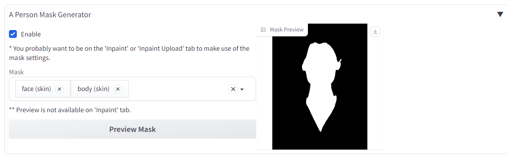
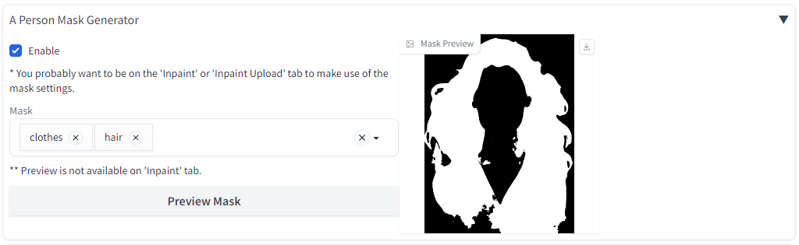

# Face Mask Generator for Forge Neo

A Forge Neo extension that generates segmentation masks for **img2img / inpainting**. Select one or more regions of a person or image, preview the resulting mask, and let the extension pass it to Forge Neo for the next generation.

The Forge Neo integration is implemented in `scripts/a_person_mask_generator.py`. It uses Google's MediaPipe **Multi-class Selfie Segmentation** model.

> **This repository is the Forge Neo adaptation.** The earlier upstream project targets Automatic1111 and ComfyUI and is maintained in a separate repository: [djbielejeski/a-person-mask-generator](https://github.com/djbielejeski/a-person-mask-generator). That repository is not owned by ORAMAN; this adaptation is maintained separately.

## Features

- Automatically generate a mask from the source image in Forge Neo's **img2img** workflow.
- Select one or several mask categories and combine their regions.
- Preview the generated mask before starting generation.
- Expand or shrink the selected area with mask dilation/erosion.
- Optionally override Forge Neo's inpainting settings from the extension.
- Download the segmentation model automatically on first use and reuse the local copy afterwards.

## Mask categories

The extension exposes these categories from MediaPipe's multiclass segmentation model:

| Category | Region |
| --- | --- |
| `background` | Background |
| `hair` | Hair |
| `body (skin)` | Visible body skin |
| `face (skin)` | Facial skin |
| `clothes` | Clothing |

You can select multiple categories. Their masks are combined into a single result. The model's `others/accessories` category is not exposed by the current Forge Neo UI.

The generated mask uses **white for selected/masked areas** and **black for unselected areas**.

## Installation

### Option 1 — Install from the Forge Neo Extensions page

If your Forge Neo build supports installing extensions from a Git URL:

1. Open **Extensions** and choose the install-from-URL option.
2. Enter this repository URL:
   `https://github.com/ORAMAN/Face-mask-generator-for-Forge-Neo.git`
3. Install the extension and restart Forge Neo completely.

### Option 2 — Install manually

Open a terminal and change to your Forge Neo installation directory. Clone the repository into its `extensions` directory:

```powershell
cd <FORGE_NEO>\extensions
git clone https://github.com/ORAMAN/Face-mask-generator-for-Forge-Neo.git
```

Install the dependency using **the same Python interpreter that Forge Neo uses**. For a standard virtual environment, run:

```powershell
cd <FORGE_NEO>
.\venv\Scripts\python.exe -m pip install -r .\extensions\Face-mask-generator-for-Forge-Neo\requirements.txt
```

If your Forge Neo environment is named differently (for example, `venv313`), replace `.\venv\Scripts\python.exe` with the path to that environment's Python executable. Installing MediaPipe into a different system Python will not make it available to Forge Neo.

Restart Forge Neo after installation.

## First run and model download

The extension requires the MediaPipe Python package listed in [requirements.txt](requirements.txt). On first use, it downloads Google's model file:

`selfie_multiclass_256x256.tflite`

The model is stored in Forge Neo's `models/mediapipe/` directory. An internet connection is required for the initial download; subsequent runs use the local file. The model is published by Google in the [MediaPipe image-segmentation model collection](https://developers.google.com/mediapipe/solutions/vision/image_segmenter#multiclass-model).

## How to use

1. Restart Forge Neo and open **img2img**.
2. Expand **A Person Mask Generator**.
3. Enable the extension using **Enable**.
4. Choose one or more entries in **Mask**.
5. Inspect **Mask Preview**. You can also change the selected categories or dilation/erosion value and preview the result again.
6. Adjust the mask boundary if needed, then start generation.

The preview is not available on the separate **Inpaint** tab; use the img2img tab to check the mask.

### Settings

| Setting | Description |
| --- | --- |
| **Enable** | Turns automatic mask generation on or off. Disabled by default. |
| **Mask** | One or more segmentation categories to include in the mask. |
| **Mask dilation / erosion, pixels** | Positive values expand the white region; negative values shrink it. `0` leaves the mask boundary unchanged. The available range is `-64` to `64`. |
| **Preview Mask** | Generates a preview from the current img2img canvas image. |
| **Override mask settings** | When enabled, the extension also applies the inpainting settings below. Disabled by default. |
| **Mask blur** | Blur radius for the generated mask. Default: `4`. |
| **Mask mode** | Choose **Inpaint masked** or **Inpaint not masked**. |
| **Masked content** | Select the fill behavior: `fill`, `original`, `latent noise`, or `latent nothing`. Default: `original`. |
| **Inpaint area** | Process the whole picture or only the masked area. Default: **Whole picture**. |
| **Only masked padding, pixels** | Additional border around the masked region when **Only masked** is selected. Default: `32`. |

The mask category threshold is currently fixed in the implementation; there is no confidence-threshold slider in the Forge Neo UI.

## Examples

The images below illustrate mask results and settings inherited from the earlier project. They demonstrate the type of masks the segmentation model can produce; they are **not screenshots of the current Forge Neo interface**.

### Face


### Face and body



### Clothes and hair



## Troubleshooting

- **The extension does not appear:** check that the repository is directly inside `<FORGE_NEO>/extensions/Face-mask-generator-for-Forge-Neo/`, then restart Forge Neo. The extension entry point is `scripts/a_person_mask_generator.py`.
- **`No module named mediapipe`:** install `requirements.txt` with the Python executable used by Forge Neo, not with another system Python.
- **The model cannot be downloaded:** check the internet connection and access to the Google-hosted model URL. The model is only downloaded when the local file is missing.
- **No mask is generated:** make sure **Enable** is checked, an img2img source image is loaded, and at least one mask category is selected.
- **The result covers too much or too little:** try a positive dilation value to expand the selected region or a negative value to shrink it.

For diagnosis, check the Forge Neo terminal output for the extension's error messages.

## Repository layout

- `scripts/a_person_mask_generator.py` — Forge Neo img2img extension and mask-generation logic.
- `requirements.txt` — Python dependency declaration (`mediapipe>=0.10.13`).
- `a_person_mask_generator_comfyui.py` and `a_person_face_landmark_mask_generator_comfyui.py` — ComfyUI node modules retained from the upstream project; they are not the Forge Neo extension entry point.
- `mask-image.py` — standalone legacy/test script; it is not used by the Forge Neo extension.

## Attribution and license

This adaptation is based on [A Person Mask Generator](https://github.com/djbielejeski/a-person-mask-generator) by David Bielejeski, which provides the original MediaPipe-based segmentation implementation and examples. The upstream repository contains its own history and documentation for the Automatic1111 and ComfyUI versions.

The repository includes the original [MIT license](LICENSE). See that file for the license terms and copyright notice.
