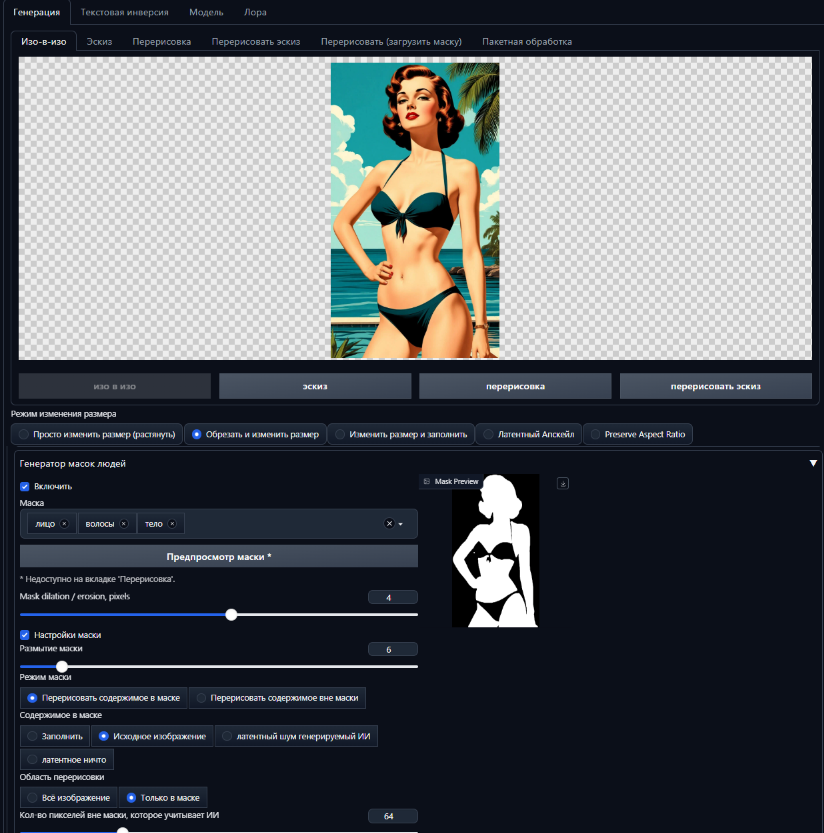

# Генератор масок лиц и частей тела для Forge Neo

Расширение для **Forge Neo**, которое автоматически создаёт маску по исходному изображению в режиме **img2img**. Маска помогает ограничить область перерисовки: например, выделить лицо, волосы, кожу тела, одежду или фон, не подготавливая маску вручную.

Для сегментации используется модель MediaPipe Selfie Segmentation. Расширение анализирует исходное изображение, объединяет выбранные категории и передаёт полученную маску в процесс генерации Forge Neo.

> Проект адаптирован для Forge Neo на основе предыдущего проекта [A Person Mask Generator](https://github.com/djbielejeski/a-person-mask-generator), созданного David Bielejeski. Исходный репозиторий принадлежит автору-предшественнику, а не ORAMAN; документация и интеграция этой версии предназначены для Forge Neo.

## Возможности

- Автоматическое создание маски по изображению в **img2img**.
- Выбор одной или нескольких областей сегментации.
- Предварительный просмотр результата до запуска генерации.
- Расширение или сужение маски с помощью дилатации и эрозии.
- Настройка размытия маски и параметров Inpainting.
- Автоматическая загрузка модели MediaPipe при первом использовании с последующим использованием локального файла.

## Доступные области маски

| Область | Что выделяется |
| --- | --- |
| **Лицо** | Кожа лица |
| **Волосы** | Волосы |
| **Тело** | Видимые участки кожи тела |
| **Одежда** | Одежда |
| **Фон** | Фон вокруг человека |

Можно выбирать несколько категорий одновременно — они объединяются в одну маску. Категория аксессуаров, присутствующая в исходной модели MediaPipe, в текущем интерфейсе расширения не предлагается.

В результате **белым** обозначается область маски, которую нужно обрабатывать, а **чёрным** — область вне маски.

## Установка

### Установка через интерфейс Forge Neo

Если используемая сборка Forge Neo поддерживает установку расширений по Git URL:

1. Откройте вкладку **Extensions** и выберите установку расширения по URL.
2. Укажите адрес репозитория: `https://github.com/ORAMAN/Face-mask-generator-for-Forge-Neo.git`.
3. Установите расширение и полностью перезапустите Forge Neo.

### Ручная установка

Откройте терминал в каталоге установки Forge Neo и выполните:

```powershell
cd <ПАПКА_FORGE_NEO>\extensions
git clone https://github.com/ORAMAN/Face-mask-generator-for-Forge-Neo.git
```

Зависимости необходимо устанавливать именно в Python-среду, которую использует Forge Neo. Например, если виртуальная среда называется `venv`:

```powershell
cd <ПАПКА_FORGE_NEO>
.\venv\Scripts\python.exe -m pip install -r .\extensions\Face-mask-generator-for-Forge-Neo\requirements.txt
```

Если в вашей сборке используется другое имя виртуальной среды, например `venv313`, укажите соответствующий путь к `python.exe`. Установка зависимости в другой системный Python не сделает её доступной внутри Forge Neo.

После установки перезапустите Forge Neo.

## Первый запуск

Расширение использует пакет `mediapipe`, указанный в `requirements.txt`. При первом запуске оно загружает модель `selfie_multiclass_256x256.tflite` и сохраняет её в каталоге моделей Forge Neo `models/mediapipe/`. Поэтому для первой загрузки модели требуется подключение к интернету.

## Использование

1. Откройте вкладку **img2img** и загрузите исходное изображение.
2. Разверните блок **«Генератор масок людей»**.
3. Включите расширение флажком **«Включить»**.
4. Выберите одну или несколько областей: лицо, волосы, тело, одежду или фон.
5. Нажмите **«Предпросмотр маски»** и проверьте, какие участки выделены.
6. При необходимости измените дилатацию/эрозию, параметры маски и настройки Inpainting, после чего запускайте генерацию.

Предварительный просмотр недоступен на отдельной вкладке **«Перерисовка»**. Для проверки маски используйте **img2img**.

### Основные параметры

| Параметр | Назначение |
| --- | --- |
| **Включить** | Разрешает автоматическое создание и применение маски. По умолчанию выключено. |
| **Маска** | Выбор категорий, которые будут объединены в маску. |
| **Mask dilation / erosion, pixels** | Изменяет границу маски. Положительное значение расширяет выделенную область, отрицательное — сужает. Диапазон: от `-64` до `64`; `0` не меняет границу. |
| **Предпросмотр маски** | Создаёт изображение маски для проверки результата. |
| **Настройки маски** | Включает переопределение настроек Inpainting параметрами расширения. По умолчанию выключено. |
| **Размытие маски** | Степень размытия границы маски. Значение по умолчанию — `4`. |
| **Режим маски** | Выбор между перерисовкой выделенной области и перерисовкой области вне маски. |
| **Содержимое в маске** | Способ заполнения обрабатываемой области: `fill`, `original`, `latent noise` или `latent nothing`. По умолчанию используется исходное изображение. |
| **Область перерисовки** | Обрабатывать всё изображение или только область маски. |
| **Отступ для области маски** | Размер дополнительного поля вокруг выделенной области при выборе перерисовки только маски. Значение по умолчанию — `32` пикселя. |

Порог уверенности модели в текущем интерфейсе фиксирован и отдельным ползунком не настраивается.

## Пример

Ниже показан пример работы расширения в интерфейсе Forge Neo: исходное изображение, блок настроек генератора и предварительный просмотр маски.



## Устранение неполадок

- **Расширение не отображается.** Проверьте, что каталог проекта находится непосредственно в `<ПАПКА_FORGE_NEO>/extensions/Face-mask-generator-for-Forge-Neo/`, а затем перезапустите Forge Neo.
- **Ошибка `No module named mediapipe`.** Установите зависимости через Python, используемый вашей сборкой Forge Neo.
- **Модель не загружается.** Проверьте подключение к интернету и наличие файла `models/mediapipe/selfie_multiclass_256x256.tflite`.
- **Маска не создаётся.** Убедитесь, что расширение включено, исходное изображение загружено в img2img и выбрана хотя бы одна категория.
- **Маска слишком большая или маленькая.** Попробуйте положительное значение дилатации для расширения выделения или отрицательное значение для его сужения.

Подробности ошибок можно посмотреть в консоли, из которой запущен Forge Neo.

## Состав проекта

- `scripts/a_person_mask_generator.py` — интеграция с Forge Neo, интерфейс и создание маски.
- `requirements.txt` — зависимость `mediapipe>=0.10.13`.
- `a_person_mask_generator_comfyui.py` и `a_person_face_landmark_mask_generator_comfyui.py` — модули узлов ComfyUI, сохранённые от предшествующего проекта; они не являются точкой входа расширения Forge Neo.
- `mask-image.py` — отдельный вспомогательный скрипт, не используемый расширением при обычной работе.

## Лицензия

В репозитории сохранён файл [LICENSE](LICENSE) с условиями лицензии MIT и исходным уведомлением об авторских правах.
